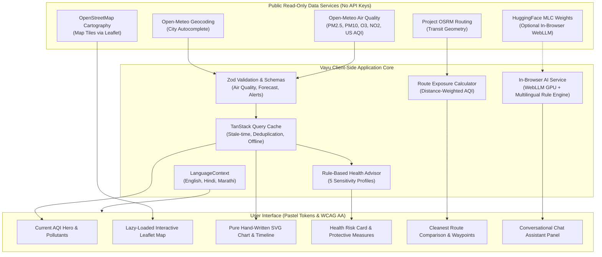

# Vayu (वायु) — Urban Air Quality Assistant

> **"Know your air. Breathe smarter."**
> Frontend-only, privacy-first urban atmospheric copilot for the Google Promptwars hackathon.

[](https://www.typescriptlang.org/)
[](https://vitejs.dev/)
[](https://tailwindcss.com/)
[](./LICENSE)

---

## Architecture Overview

Vayu operates **100% client-side** in your browser without any custom backend, cloud database, server sessions, or external tracking.



---

## Key Features

1. **Live Air Quality & Pollutant Tracking:**
   - Real-time US AQI index calculated across 6 primary pollutants (PM2.5, PM10, Ozone, NO2, CO, SO2).
   - Validated through strict Zod schemas with fallback gracefully handling missing fields.
   - Honest disclosure: clearly categorized as numerical atmospheric model estimates from Open-Meteo.

2. **24-Hour Predictive Forecast Suite:**
   - Lightweight, responsive, pure hand-written SVG forecast chart with color bands and peak/cleanest annotations.
   - Profile-aware continuous safe window finder (e.g. runners ≤80 AQI, sensitive/asthma ≤50 AQI).

3. **Cleanest Route Navigation:**
   - Multi-modal routing (walking, cycling, driving) via public OSRM.
   - Waypoint air sampling and distance-weighted exposure score calculation (`sum(segment_km * aqi) / total_km`).
   - Cleanest route identification and percentage exposure improvement comparison.

4. **In-Browser Conversational AI:**
   - Client-side WebLLM support utilizing WebGPU acceleration.
   - Fast, instant rule-based multilingual fallback supporting natural English, Hindi (हिंदी), and Marathi (मराठी).
   - Instant critical alert warnings for acute symptoms (chest pain, respiratory distress).

5. **Personalized Health Advisor:**
   - Tailored advice across 5 profiles: General Public, Children, Seniors (65+), Athletes/Runners, and Asthma/Sensitive.
   - Actionable protective measures with expandable details and certified N95/FFP2 respirator guidelines.

6. **Accessibility & Design Tokens:**
   - Dedicated "Reduce Motion" mode respecting `prefers-reduced-motion` and custom app-level preference.
   - Accessible WCAG AA contrast tokens in both Light and Dark themes.

---

## Getting Started

```bash
# Clone the repository
git clone https://github.com/omkar-tupe483/Vayu.git
cd Vayu

# Install pinned dependencies
npm install

# Start local development server
npm run dev

# Run unit tests (39 tests)
npm run test

# Run strict type checking and linting
npm run typecheck
npm run lint

# Build production bundle
npm run build
```

---

## Attribution & Disclosures

- **Atmospheric Data:** Modelled estimates provided by [Open-Meteo](https://open-meteo.com/).
- **Cartography:** Map tiles by [OpenStreetMap](https://www.openstreetmap.org/) contributors.
- **Routing:** Geometry by [Project OSRM](https://project-osrm.org/).
- **Health Information:** Educational guidance based on WHO and US EPA ambient air quality categories; never clinical diagnosis or medical prescriptions.
