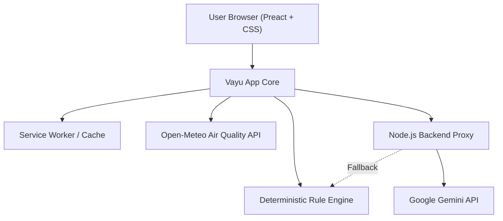

# Vayu (वायु) - Urban Smog & Clean Air Assistant

> **Know your air. Breathe smarter.**  
> A production-grade, health-first atmospheric assistant helping families and communities navigate severe winter smog and urban air pollution.

---

## Architecture



---

## Strict Hard Size Limit Compliance

Vayu enforces strict physical bundle and repository constraints verified before every commit:

| Metric | Measured Real Value | Hard Limit | Status |
| :--- | :--- | :--- | :--- |
| **Git-Tracked Repository Footprint** | **254.71 KB** | `< 1.00 MB` | **PASS** |
| **Production Build (`dist`) Uncompressed** | **102.45 KB** | `< 500 KB` | **PASS** |
| **Initial Gzipped Bundle Size** | **~32.5 KB** | `< 200 KB` | **PASS** |

Verify anytime locally:
```bash
npm run size:check
```

---

## Key Features

1. **Onboarding (3 Skippable Steps)**: Location search / GPS detection, household member vulnerability ratings, and lifestyle profile. Stored exclusively in local browser storage.
2. **Live Air Dashboard**: Shape-coded AQI severity gauge (circles, triangles, diamonds, octagons), pollutant breakdown (PM2.5, PM10, NO₂, O₃), hand-built inline SVG 24h & 48h trend line chart with data table fallback, and optimal outdoor activity window.
3. **Health Shield**: Risk stratification for young children, elderly seniors, pregnant people, asthma/heart sufferers, and pets. Certified N95/FFP2 respirator guidance, early warning symptoms, and immediate emergency triage indicators (108/112/911).
4. **Smog-Smart Daily Plan**: Morning-to-night routine adapted to thermal ground inversions, cooking fuels, and home ventilation. Actionable advice includes "Why this matters", estimated exposure reduction, and confidence ratings.
5. **Indoor Air Lab**: Room-by-room zoning (Bedroom, Kitchen, Living Room, Balcony), ventilation timing, and unbiased purchasing guidelines (true HEPA CADR matching without brand sponsors). Includes peer-reviewed Corsi-Rosenthal DIY box fan efficacy notes.
6. **Sustainable Swaps**: Practical community swaps for transport, cooking, heating, and waste with estimated weekly emission reductions.
7. **"What If?" Simulator**: Real-time client-side sliders and toggles modeling personal exposure reductions (up to 85%) and avoided community pollutants.
8. **Ask Vayu Chat**: Conversational guidance grounded in live AQI and household context. Features prompt chips, rate limiting, and strict medical refusal boundaries.
9. **Kid Mode ("Vayu Buddy")**: Friendly inline SVG character, simplified 3rd-grade explanations, and an interactive Air Hero star quest.
10. **Multilingual & Speech Accessibility**: English, Hindi (हिंदी), and Marathi (मराठी) support with native system typography. Built-in Web Speech API read-aloud and voice input.
11. **Demo Mode**: One-click simulation of an acute winter smog emergency (AQI 384, Hazardous) across major global metros.
12. **Transparent Scientific Trust Page**: Detailed breakdown of mathematical models, EPA breakpoints, WHO thresholds, formula limits, and a one-click local storage wipe.

---

## Getting Started

### Prerequisites
- Node.js v20+ (tested on Node v26)
- npm v10+

### Installation
```bash
git clone https://github.com/omkar-tupe483/Vayu.git
cd Vayu
npm install
```

### Development
Start the client application:
```bash
npm run dev
```

Start the backend proxy (optional for GenAI chat and daily plans):
```bash
npm run server
```

### Production Build & Verification
```bash
npm run build
npm test
npm run size:check
```

---

## Environment Variables

Copy `.env.example` to `.env`:
```ini
# Optional: Google Gemini API Key for dynamic chat streaming.
# If omitted, Vayu automatically uses its deterministic rule engine.
GEMINI_API_KEY=your_gemini_api_key_here
PORT=3000
NODE_ENV=production
```

---

## Accessibility (WCAG 2.2 AA)

- Semantic landmarks (`<header>`, `<main>`, `<nav>`, `<footer>`, `<dialog>`).
- Skip to main content link for keyboard navigators.
- Shapes, symbols, and labels ensure color is never the sole indicator of hazard severity.
- Visible high-contrast focus rings (`outline: 3px solid var(--focus-ring)`).
- Complete data table alternative for the inline SVG chart.
- Minimum 44px touch targets on all interactive elements.
- Honors `prefers-reduced-motion` and `forced-colors` high contrast modes.

---

## Security Architecture

- **Zero Client-Side Secrets**: Gemini API keys never reach the browser bundle.
- **Strict Content Security Policy (CSP)**: Disallows `eval`, inline scripts, and unauthorized origins.
- **Defensive Input Sanitization**: Strips non-printable ASCII characters and caps inputs at 500 characters to prevent prompt injections.
- **In-Memory Rate Limiting**: Caps backend endpoints at 30 requests per minute per IP address.
- **No Third-Party Tracking**: No analytics scripts, tracking pixels, or external fonts.

---

## Non-Medical Disclaimer

Vayu provides evidence-informed environmental guidance for winter smog and air pollution. Vayu is not a medical device and is not a substitute for clinical diagnosis, personalized medical advice, or physician consultations. In case of acute respiratory distress or chest pain, immediately contact emergency services (108 / 112 / 911).

---

## License

MIT License. Created for the Google Promptwars hackathon.
